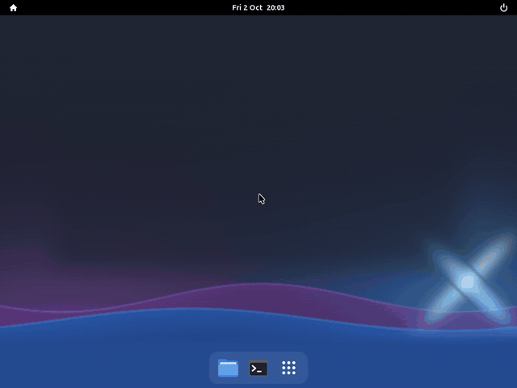
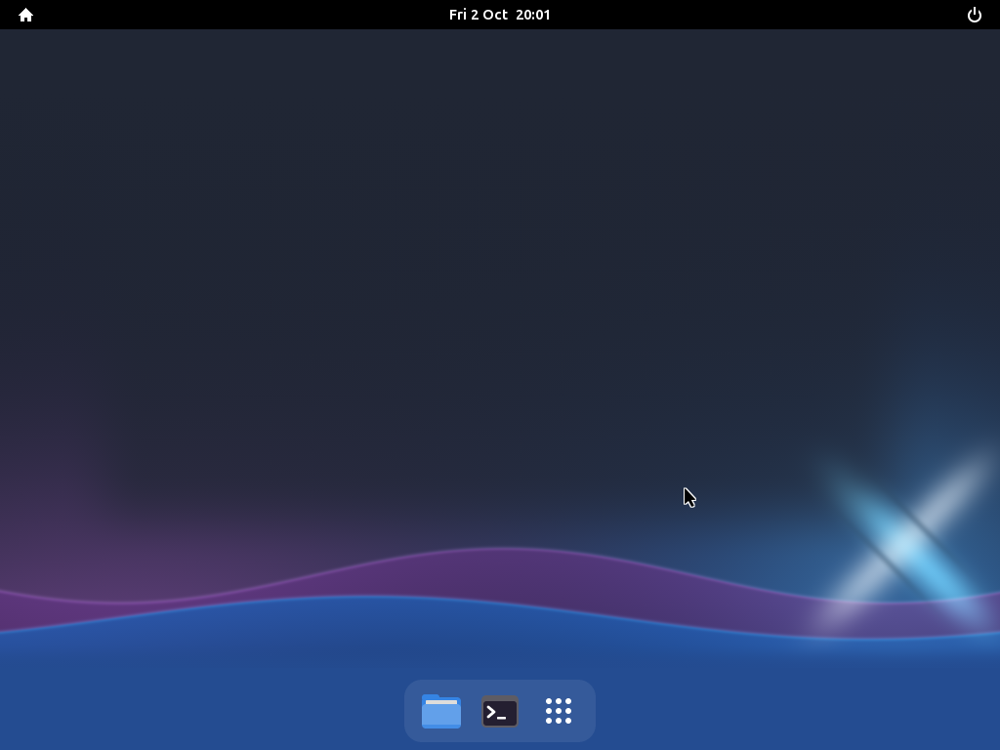
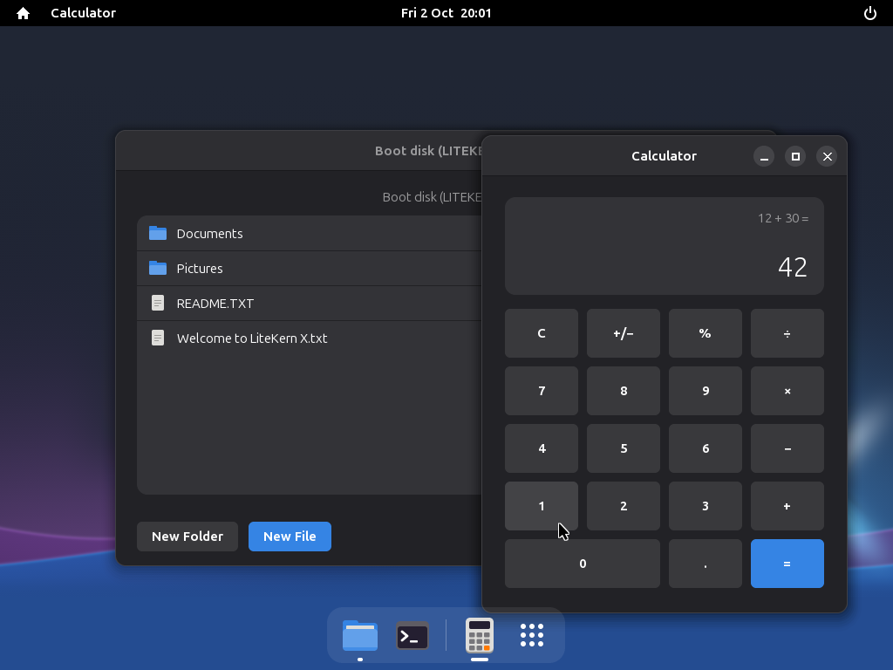
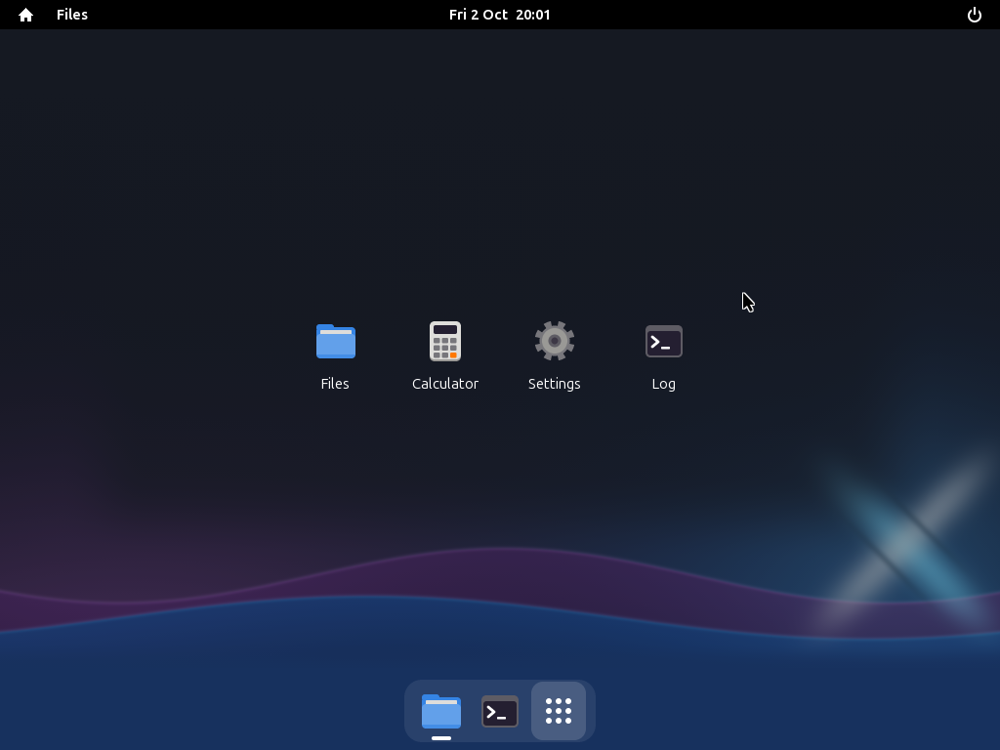
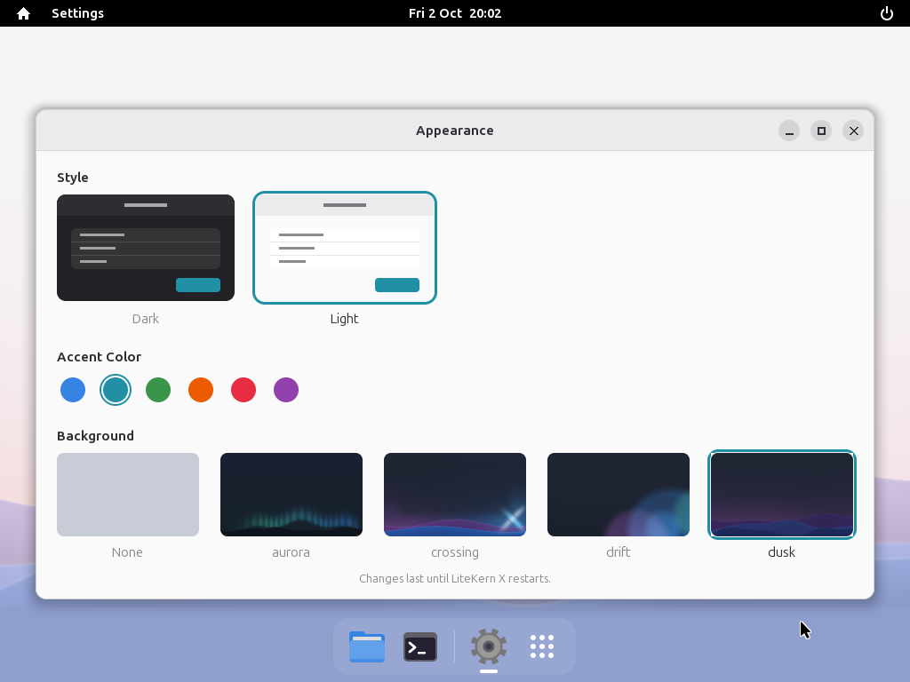

  

<h1 align="center">LiteKern X</h1>

  A lightweight Linux-based desktop system with its own GUI, built for the ASUS Eee PC 1000HE netbook.

  

## What is it?

LiteKern X is a small, fast desktop system for one 2009 netbook, the ASUS Eee PC 1000HE (Intel Atom N270, 32-bit x86).
It runs on the Linux kernel, which handles the hardware: Ethernet, Wi-Fi and everything else. On top of that sits LiteKern's own desktop: a dock, an app menu, and windows you can move around, like on Windows or GNOME. The look, the window handling and the apps are all written for this project.
LiteKern X is a clean-slate rewrite of LiteKern, which was a from-scratch kernel. It keeps v1's app model (KERN86).

## Screenshots

<table>
  <tr>
    <td></td>
    <td></td>
  </tr>
  <tr>
    <td align="center">The desktop</td>
    <td align="center">Two apps at once</td>
  </tr>
  <tr>
    <td></td>
    <td></td>
  </tr>
  <tr>
    <td align="center">The app menu</td>
    <td align="center">Light style, in Settings</td>
  </tr>
</table>

## What it can do

- **Linux underneath:** the Linux kernel provides hardware support, so drivers just work.
- **Networking:** Ethernet and Wi-Fi.
- **Real windows:** move them, minimise, maximise with several apps open at once. Windows will soon run on X11 (see STATUS).
- **A dock and an app menu:** favourites stay in the dock; open apps show a dot underneath.
- **Web browser:** a custom browser built on NetSurf, with JavaScript support coming (see STATUS).

**Apps:**

- **Files** browses the hard drive, makes folders and files, renames and deletes them, and opens text files (Max 64KB) and images.
- **Calculator** does exact decimal sums.
- **Settings** switches between dark and light, six accent colours and five backgrounds, network settings, user settings, system settings.
- **Log** shows what the system is doing.
- **Stays up:** if an app crashes or freezes, only that app closes.
- Shut down and restart from the power menu.

## Try it

There's no download yet; the first release is coming (see STATUS). For now you build it yourself on Windows, using WSL:

1. Install [WSL](https://learn.microsoft.com/windows/wsl/install) with Ubuntu.
2. In this folder, open PowerShell and run `wsl sudo bash tools/setup-wsl.sh` once.
3. Run `wsl make run`. LiteKern X starts in a window.

To run it on a real Eee PC 1000HE, see [Testing on the Eee PC](docs/HARDWARE-TEST.md).

## Status

# LiteKern X is a work in progress.

**Done:**

- Moved onto the Linux kernel.
- Ethernet and Wi-Fi.
- The desktop, windows and apps.
- Themes and wallpapers.

**In progress:**

- X11 window support.
- JavaScript in the browser.

**Next:**

- The first release: a download, a website and documentation.

**Later:**

- Audio

The full plan is in LiteKernX-Roadmap/.

## For developers

- [Developing LiteKern X](docs/DEVELOPING.md): building, testing, the VMs and where everything is
- [Making an app](docs/APPS.md): write your own app for LiteKern X
- [The roadmap](LiteKernX-Roadmap/): what's done and what's next
